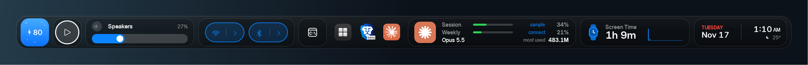
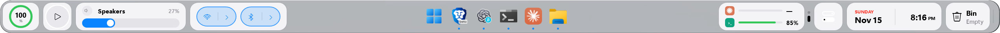
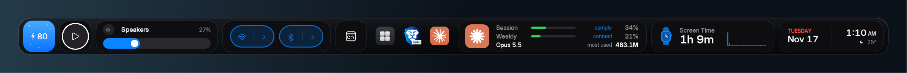
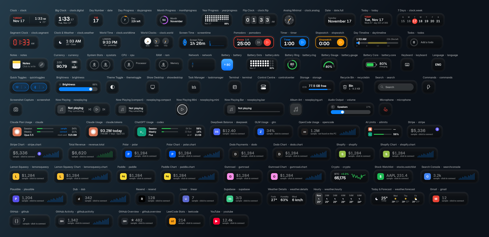
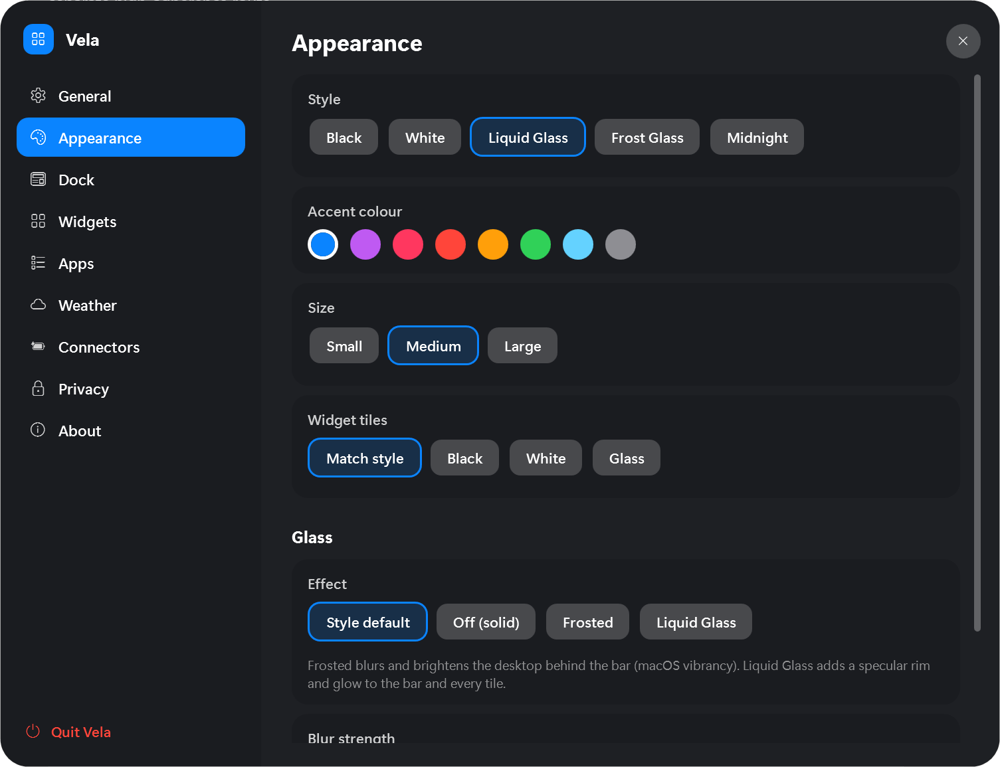

# Vela

A native widget dock for Windows 10 and 11: your apps and live widgets in one glassy bar on the bottom
(or top) edge of the screen. While it runs, the Windows taskbar steps aside; quit Vela and it comes back
exactly as it was.

Personal project, inspired by the look and feel of lumabar.xyz, rebuilt natively in C#/WPF on .NET 10:
no Electron, no Chromium. Idle cost: ~0 % CPU, ~40 MB working set.

## What's in it

- **Apps:** Start, your pinned taskbar apps and every open window, grouped per app, with open indicators
  (dot, large dot or line), focus outline, attention bounce, live window previews, jump lists, End task for
  frozen apps, and optional macOS-style magnification.
- **100+ widgets** in 13 categories:
  - *Clocks & productivity:* clock, big/flip/analog/segment clocks, world clocks and world time, date, today,
    7 days, day timeline, day/month/year progress, calendar, screen time, pomodoro, timer, stopwatch, todos,
    notes, currency; the calendar shows your Google, Outlook or iCloud events from their private iCal links.
  - *System:* CPU/RAM/network, top CPU/RAM, five battery styles, Wi-Fi/Bluetooth toggles, Control Centre,
    brightness, theme toggle, keyboard, input language, notifications, show desktop, Task Manager, terminal.
  - *Apps & files:* recently opened, search, commands, screenshot, storage, recycle bin, downloads stack.
  - *Notifications:* unread badges on dock icons, a notifications tile and a WhatsApp tile (Windows asks once for
    notification access).
  - *Media:* now playing (5 layouts), a sound card with output switching and a per-app volume mixer, microphone.
  - *Accounts (paste a key, kept encrypted on this PC):* Claude and ChatGPT/Codex plan limits, Claude tokens,
    DeepSeek, GLM, OpenCode; Stripe, Polar, Lemon Squeezy, Paddle, Gumroad, Shopify, Dodo and total revenue; Plausible, Dub;
    Linear, Supabase, Resend; Gmail and Search Console (sign in with your own Google OAuth client); GitHub
    (notifications, activity, overview), LeetCode, YouTube; stock watchlist, crypto.
  - *Weather:* current, status, details, hourly, today & forecast, sunrise & sunset.
- **Vela Island:** a pill at the top of the screen for music, timers, volume and power.
- **Five styles** (Black, White, Liquid Glass, Frost Glass, Midnight) with live blur, eight accent colours,
  three sizes, and a dock per display that matches what's on that screen.
- **Shortcuts:** Alt+T opens PowerShell as administrator; the Terminal tile opens PowerShell or Command Prompt.
- **Widget picker:** right-click the dock → *Widgets…*, then click to add or remove; drag to reorder while it's open.
- **Private:** no account, no server, no telemetry. Keys are encrypted with Windows DPAPI on this PC.

## Screenshots







Every widget (account widgets show sample values until connected):





## Run it

Requires the .NET 10 SDK to build (or use `tools/publish.ps1` for a self-contained copy).

```powershell
dotnet build src/Vela/Vela.csproj
src\Vela\bin\Debug\net10.0-windows10.0.19041.0\Vela.exe
```

| Command | What it does |
|---|---|
| `Vela.exe --quit` | close the running dock (restores the taskbar) |
| `Vela.exe --widgets` / `--settings` | open the picker / settings |
| `Vela.exe --restore-taskbar` | emergency: bring the Windows taskbar back |
| `Vela.exe --render <dir> [--theme <style>] [--public]` | draw the dock and every widget to PNGs, off-screen (`--public` leaves out personal data) |

Data lives in `%LOCALAPPDATA%\Vela` (settings, todos/notes, screen time, encrypted keys, logs).

## For contributors and agents

Start with [AGENTS.md](AGENTS.md), then [docs/PROGRESS.md](docs/PROGRESS.md) and [docs/ROADMAP.md](docs/ROADMAP.md).
Architecture: [docs/ARCHITECTURE.md](docs/ARCHITECTURE.md). Recipes: [docs/ADDING_A_WIDGET.md](docs/ADDING_A_WIDGET.md).
